# Clinic Digital

Aplicación móvil académica para practicar el desarrollo con **Expo**, **React Native**, **TypeScript**, **Expo Router**, **NativeWind** y servicios de **Firebase**. Incluye registro e inicio de sesión, gestión de citas, solicitudes, perfil de usuario y un test referencial de riesgo de diabetes tipo 2.

> Este proyecto es una práctica académica. Antes de distribuirlo ampliamente, se deben completar las pruebas en un APK Android y revisar las alertas de dependencias que todavía reporte `npm audit`.

## Funcionalidades

- Registro e inicio de sesión mediante Firebase Authentication.
- Perfil vinculado a la cuenta: datos de usuario en Firestore y una copia local para restaurar la sesión y el perfil.
- Reserva, consulta, reprogramación y cancelación de citas. Las citas se guardan localmente con SQLite y se sincronizan con Firestore; los bloqueos remotos ayudan a evitar reservas duplicadas por especialidad.
- Las reservas nuevas requieren conexión. Las cancelaciones hechas sin conexión quedan pendientes de sincronización.
- Solicitudes de tipo consulta, reclamo o sugerencia: se crean, consultan, editan y eliminan en la subcolección de Firestore de la cuenta.
- Consulta de atenciones, recetas y descansos médicos con datos de práctica.
- Test de riesgo de diabetes tipo 2. El resultado es referencial y no reemplaza una evaluación médica.
- Recordatorio local de cita, programado para 24 horas antes cuando corresponde y con permiso de notificaciones. Se programa en el dispositivo donde se reservó; todavía falta validarlo en un APK Android.
- Pantallas de inicio, navegación, perfil, acerca de la aplicación y mensajes de confirmación/resultado con componentes reutilizables.

## Persistencia y sincronización

| Información | Almacenamiento |
| --- | --- |
| Cuenta y autenticación | Firebase Authentication |
| Perfil del paciente | `usuarios/{uid}` en Cloud Firestore |
| Citas | SQLite en el dispositivo y sincronización con `usuarios/{uid}/citas` en Firestore |
| Bloqueo de especialidad | `usuarios/{uid}/bloqueos_especialidad` en Firestore |
| Solicitudes | `usuarios/{uid}/solicitudes` en Firestore |
| Historial de atenciones, recetas y descansos | Datos de práctica locales |

Las pantallas de citas y solicitudes cargan sus datos al abrirse o al volver a ellas; **actualmente no usan listeners `onSnapshot()` para actualizarse en tiempo real mientras permanecen abiertas**. La sincronización entre dispositivos ocurre mediante las operaciones de Firestore y las recargas/sincronizaciones implementadas.

Las solicitudes se guardan en la cuenta del paciente. Esta versión no incluye un panel administrativo ni un flujo para responderlas desde la aplicación.

## Tecnologías y paquetes principales

Las versiones instaladas están registradas en `package.json` y `package-lock.json`. Para mantener compatibilidad con el SDK, instala los módulos Expo con `npx expo install`.

| Paquete / tecnología | Uso |
| --- | --- |
| Expo SDK 57, React Native y TypeScript | Plataforma de la aplicación móvil y tipos del proyecto |
| `expo-router` | Navegación basada en archivos en `src/app/` |
| `firebase` | Firebase Authentication y Cloud Firestore |
| `expo-sqlite` | Persistencia local de citas en Android/iOS |
| `@react-native-async-storage/async-storage` | Persistencia de la sesión de Firebase y copia local del perfil |
| `expo-network` | Comprobación de conectividad antes de sincronizar o reservar |
| `expo-notifications` | Programación y cancelación de recordatorios locales |
| `nativewind` | Estilos con clases utilitarias en React Native |
| `@expo/vector-icons`, `@expo/ui` | Iconos y componentes de interfaz |
| `react-native-reanimated`, `react-native-gesture-handler`, `react-native-screens`, `react-native-safe-area-context` | Animaciones, gestos y soporte de navegación/pantallas |
| `eslint`, `eslint-config-expo`, `typescript`, `babel-preset-expo`, `tailwindcss` | Validación, compilación y estilos durante el desarrollo |

## Requisitos

- Node.js y npm.
- Un proyecto de Firebase con **Authentication (correo y contraseña)** y **Cloud Firestore** habilitados.
- Para ejecutar con Expo Go: Expo Go instalado en un teléfono.
- Para generar e instalar un APK local: Android Studio, Android SDK, Java/JDK y un emulador o teléfono Android. En el teléfono se puede habilitar la depuración USB.

## Clonar el repositorio

Clona el repositorio sin indicar una rama para descargar la rama que está configurada como predeterminada en GitHub:

```bash
git clone https://github.com/Ghost12G/Aplicacion_Movil.git
cd Aplicacion_Movil
```

El archivo `.env` no se incluye en Git. Cada persona que clone el proyecto debe crear su propio archivo a partir de `.env.example` y configurar sus valores de Firebase antes de ejecutar la aplicación.

## Configuración de Firebase

1. Crea o selecciona el proyecto de Firebase y habilita Authentication con el proveedor de correo y contraseña.
2. Crea la base de datos de Cloud Firestore.
3. Copia `.env.example` como `.env` y completa los valores de la configuración de la aplicación web de Firebase:

   En Windows (CMD):

   ```cmd
   copy .env.example .env
   ```

   En PowerShell:

   ```powershell
   Copy-Item .env.example .env
   ```

   ```env
   EXPO_PUBLIC_FIREBASE_API_KEY=
   EXPO_PUBLIC_FIREBASE_AUTH_DOMAIN=
   EXPO_PUBLIC_FIREBASE_PROJECT_ID=
   EXPO_PUBLIC_FIREBASE_STORAGE_BUCKET=
   EXPO_PUBLIC_FIREBASE_MESSAGING_SENDER_ID=
   EXPO_PUBLIC_FIREBASE_APP_ID=
   ```

4. Publica las reglas de seguridad de [`firebase/firestore.rules`](firebase/firestore.rules) en Firebase Console.

El archivo `.env` está excluido de Git. Las variables `EXPO_PUBLIC_` se incorporan al cliente de la aplicación; no guardes contraseñas de cuentas de servicio ni claves privadas en ellas. El acceso a los documentos debe protegerse con Firebase Authentication y las reglas de Firestore.

## Instalación y ejecución

Desde la carpeta del proyecto:

```bash
npm install
npx expo start
```

Escanea el QR con Expo Go para abrir la aplicación. La reserva de citas nuevas y el envío de solicitudes requieren conexión a internet.

Comandos de validación:

```bash
npx expo-doctor
npx tsc --noEmit
npx expo lint
npm audit
```

`npm audit fix` puede aplicar correcciones compatibles. No uses `npm audit fix --force` sin revisar antes los cambios: podría instalar versiones incompatibles con Expo SDK 57. En la última revisión del proyecto quedaron alertas transitivas; deben reevaluarse antes de una distribución pública.

## Generar APK Android local

El identificador Android configurado es `com.clinicdigital.app`. Para generar los archivos nativos de Android mediante Expo y compilar una variante release local:

```bash
npx expo prebuild --platform android
npx expo run:android --variant release
```

Conecta un dispositivo Android con depuración USB habilitada o inicia un emulador. La carpeta `android/` es generada por Expo y está excluida de Git; evita editarla manualmente. El APK release suele quedar en `android/app/build/outputs/apk/release/`.

Después de instalarlo, acepta el permiso de notificaciones y prueba con una cita a más de 24 horas de distancia. Al ser un recordatorio local, solo se programa en el dispositivo donde se realizó la reserva.

## Estructura principal

```text
src/
├── app/                         # Rutas de Expo Router
├── application/services/        # Casos de uso y servicios de aplicación
├── domain/                      # Entidades y contratos de repositorios
├── infrastructure/
│   ├── firebase/                # Configuración y traducción de errores de Firebase
│   ├── repositories/            # Implementaciones Firebase, SQLite y catálogos
│   └── services/                # Sincronización de citas y notificaciones
├── presentation/
│   ├── components/              # Componentes reutilizables
│   ├── hooks/                   # Hooks de formularios y datos
│   └── screens/                 # Pantallas de la aplicación
└── shared/                      # Funciones compartidas

firebase/
└── firestore.rules              # Reglas de seguridad de Cloud Firestore
```

## Capturas

| Pantalla | Imagen |
| --- | --- |
| Inicio de sesión | 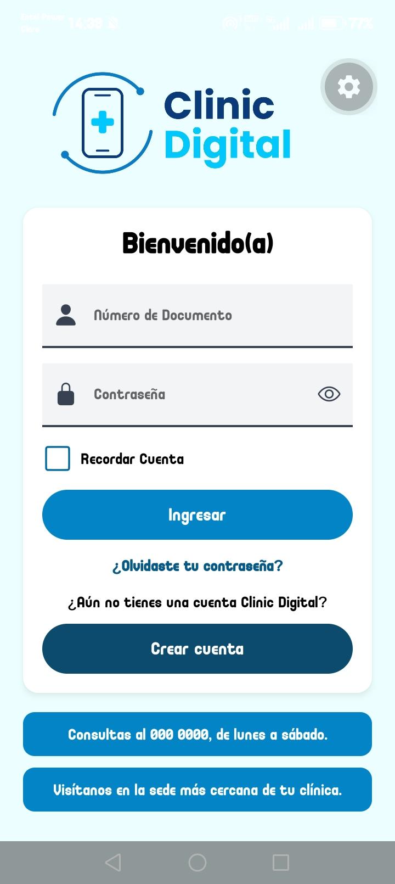 |
| Registro | 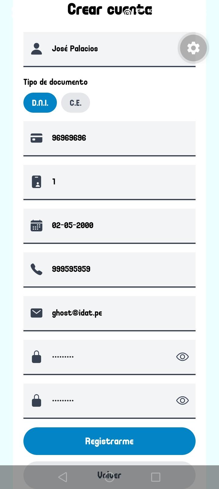 |
| Inicio | 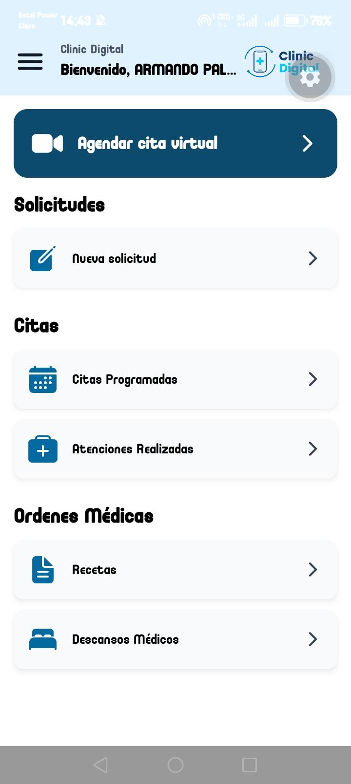 |
| Reserva: especialidad | 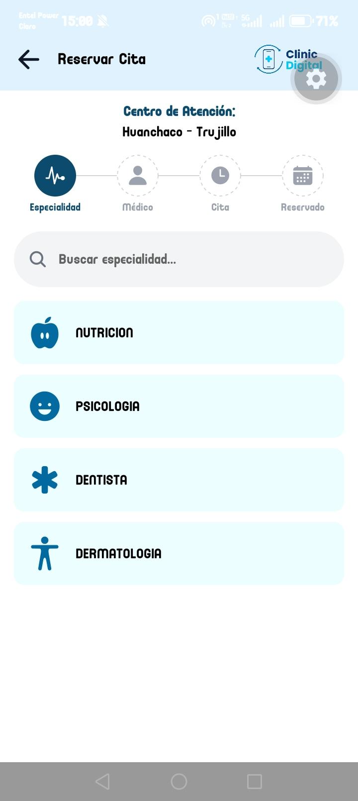 |
| Reserva: médico | 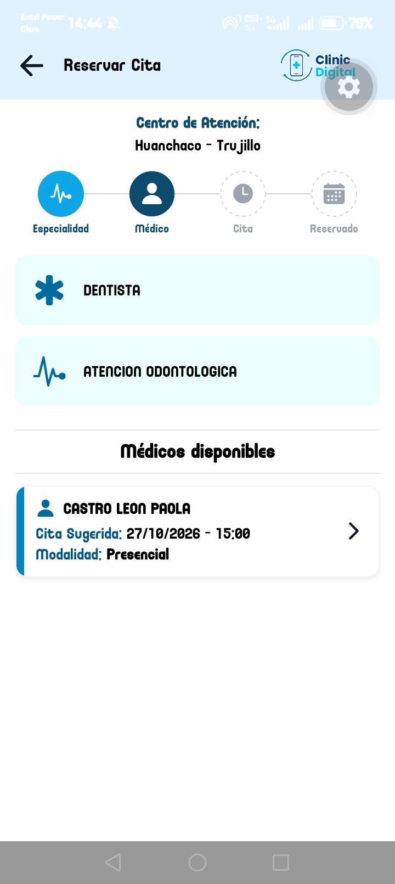 |
| Reserva: verificación | 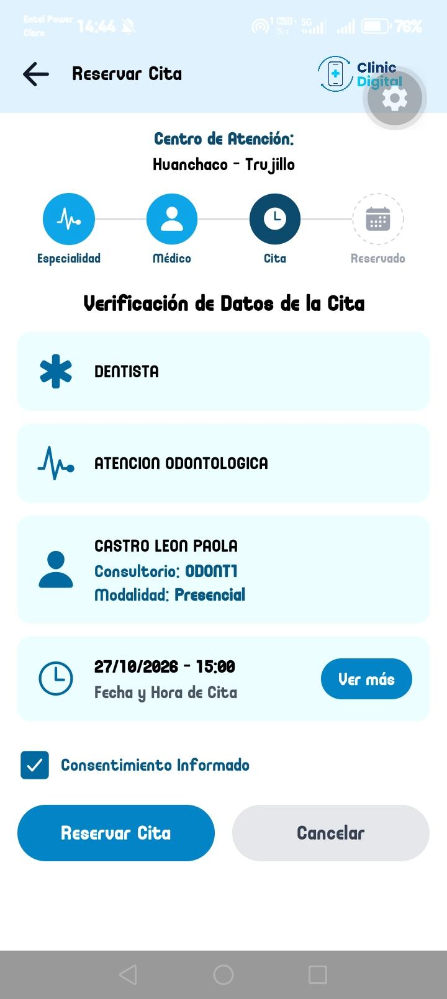 |
| Reserva: fecha y hora | 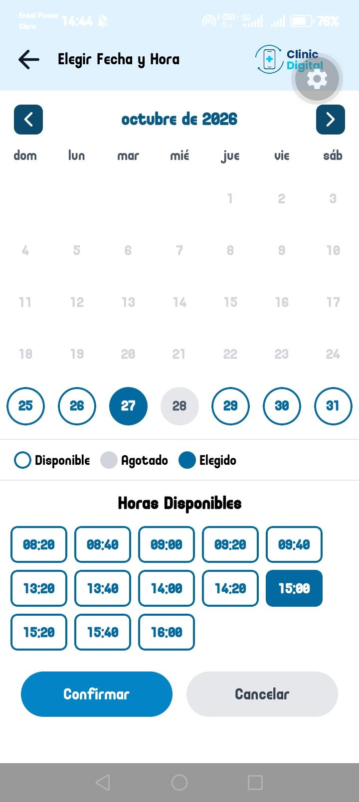 |
| Citas programadas | 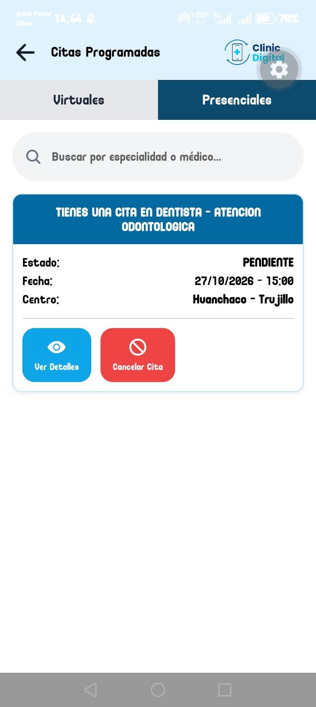 |
| Mis solicitudes | 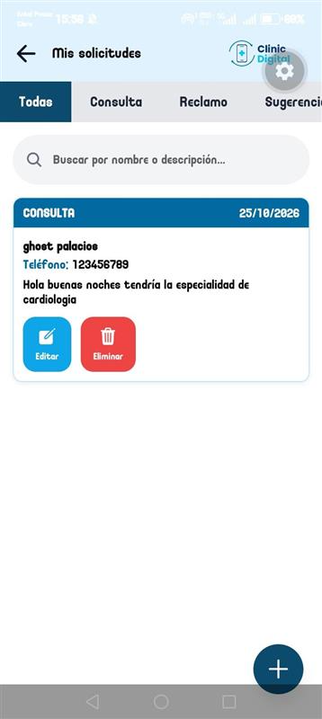 |
| Perfil | 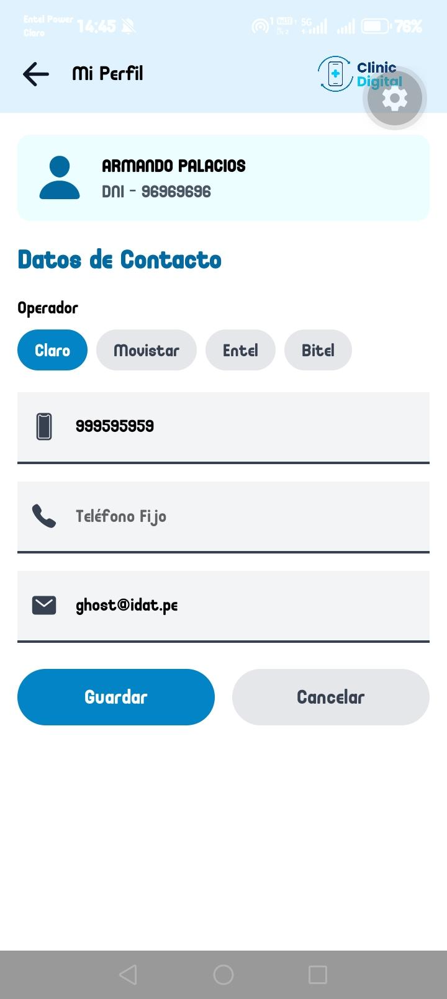 |
| Test de diabetes | 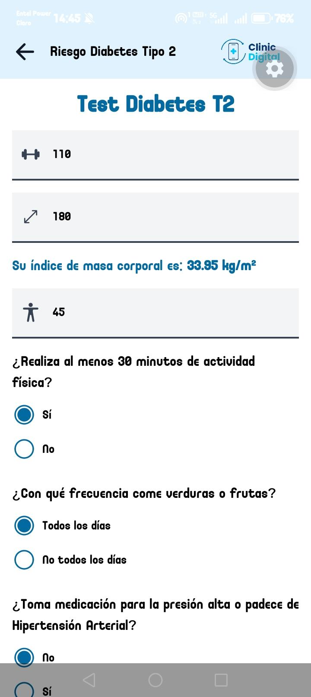 |
| Resultado del test | 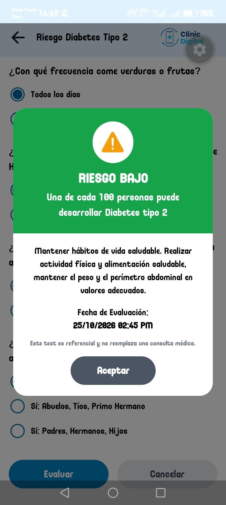 |
