# Clinic Digital

Aplicación móvil de práctica para una clínica, creada con **Expo**, **React Native**, **TypeScript**, **Expo Router** y **NativeWind**. Permite iniciar sesión con DNI y contraseña, registrarse, reservar citas, consultar atenciones, recetas y descansos médicos, editar los datos de contacto y hacer un test de riesgo de diabetes tipo 2. Está pensada como una práctica de formularios, validaciones, componentes reutilizables, hooks, navegación y manejo de datos en memoria.

## Funcionalidades

- Pantalla de inicio con el logo que pasa sola al inicio de sesión.
- Inicio de sesión con DNI y contraseña, campos obligatorios y mensajes de error visibles.
- Casilla **Recordar Cuenta**: al cerrar sesión, el login muestra la cuenta recordada.
- Registro con tipo de documento, número de documento, carácter verificador, fecha de nacimiento, celular, correo y contraseñas.
- Home con mensaje de bienvenida, nombre de la aplicación y accesos a todas las funcionalidades.
- Menú lateral con los datos del centro, Inicio, Mi Perfil, Riesgo Diabetes Tipo 2 y Cerrar Sesión.
- Reserva de cita virtual en pasos: especialidad, médico, verificación de datos y elección de fecha y hora.
- Citas programadas con pestañas Virtuales y Presenciales, detalle de la cita y cancelación con confirmación.
- Atenciones realizadas (solo consulta) separadas por tipo de atención.
- Recetas separadas en Anteriores, Mes Actual y Siguientes, con detalle de medicamentos.
- Descansos médicos (solo consulta).
- Formulario de nueva solicitud con validaciones.
- Mi Perfil para editar los datos de contacto.
- Test de riesgo de diabetes tipo 2 con cálculo del índice de masa corporal y resultado en un modal.
- Buscador que filtra mientras se escribe en las listas.

## Credenciales de demostración

Usa estos datos en la pantalla de inicio de sesión:

| Campo | Valor |
| --- | --- |
| Número de documento | `12345678` |
| Contraseña | `1234` |

También puedes crear una cuenta nueva desde **Crear cuenta** y luego iniciar sesión con ella.

## Operaciones CRUD

| Operación | Dónde se usa |
| --- | --- |
| **Crear** | Registro de usuarios y reserva de citas |
| **Leer** | Citas programadas, atenciones realizadas, recetas y descansos médicos |
| **Actualizar** | Mi Perfil (datos de contacto) |
| **Eliminar** | Cancelar una cita programada |

Los datos se guardan **solo en memoria**, sin base de datos ni API. Al cerrar o recargar la aplicación se pierden los usuarios nuevos, las citas y los cambios del perfil, y se restablece el usuario de demostración.

## Requerimientos del curso

| Requerimiento | Dónde se aplica |
| --- | --- |
| Pantalla de login con campos obligatorios | `src/app/login.tsx` |
| Pantalla Home con bienvenida, nombre de la app y accesos | `src/app/home.tsx` |
| Formulario con validaciones visibles | `src/app/solicitud.tsx` y `src/app/register.tsx` |
| Componentes reutilizables con Props y TypeScript | `src/components/` |
| `useState` | Formularios, pestañas, buscadores y modales |
| `useEffect` | Pantalla de inicio (`src/app/index.tsx`) |
| Hook personalizado | `src/hooks/useFormulario.tsx` |
| NativeWind | Estilos de todas las pantallas |

## Tecnologías

- Expo SDK 57
- React Native con TypeScript
- Expo Router
- NativeWind 4
- Iconos de `@expo/vector-icons`

## Requisitos

- Node.js
- npm
- Aplicación Expo Go en el teléfono, o un emulador de Android o iOS

## Instalación y ejecución

```bash
git clone -b Desarrollo https://github.com/Ghost12G/Aplicacion_Movil.git
cd Aplicacion_Movil
npm install
npx expo start
```

Escanea el código QR con Expo Go para abrir la aplicación en el teléfono.

## Ramas del repositorio

- `Desarrollo`: rama de trabajo con la versión entregada del proyecto. Aquí se hacen los cambios y correcciones.
- `main`: rama base del repositorio.

## Cómo se creó el proyecto

```bash
npx create-expo-app@latest Aplicacion-Movil
# Select an Expo SDK version > Latest (SDK 57)
cd Aplicacion-Movil
```

Dependencias instaladas:

```bash
npx rn-new --nativewind
npx expo install @expo/material-symbols

npm install nativewind@4.2.7 react-native-reanimated react-native-safe-area-context
npm install --save-dev tailwindcss@^3.4.17 prettier-plugin-tailwindcss@^0.5.11 babel-preset-expo
```

## Estructura principal

```text
src/
├── app/            # Rutas y pantallas de Expo Router
├── components/     # Componentes reutilizables
├── data/           # Datos en memoria y catálogos de ejemplo
├── hooks/          # Hook personalizado para formularios
├── types/          # Interfaces y tipos de TypeScript
└── utils/          # Funciones de fechas
```

## Capturas de pantalla

Las siguientes capturas muestran las pantallas principales en formato móvil.

### Inicio de sesión

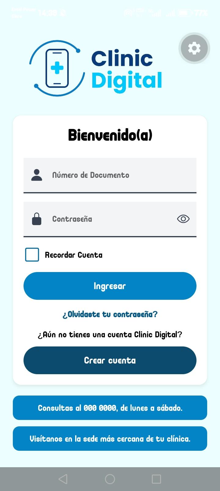

### Cuenta recordada

Después de cerrar sesión con la casilla Recordar Cuenta marcada.

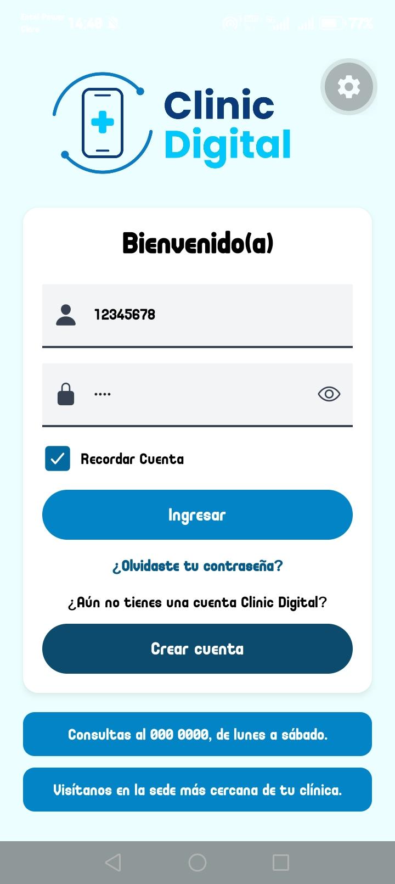

### Registro

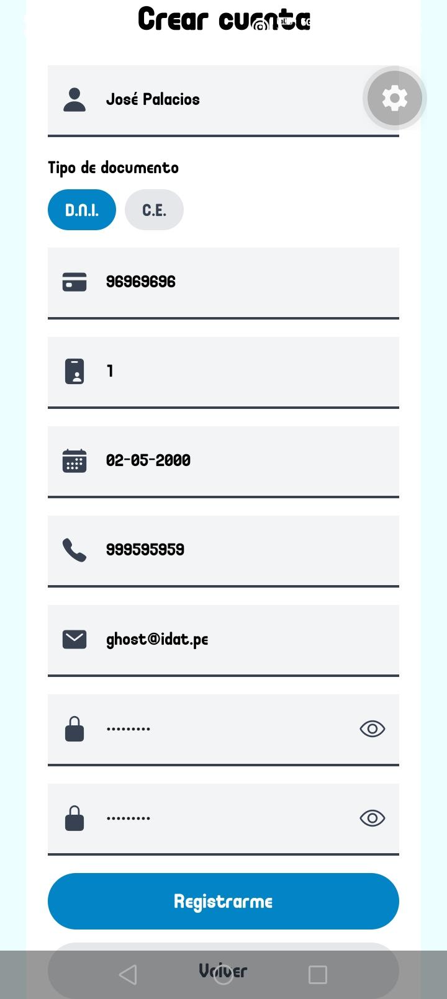

### Pantalla principal

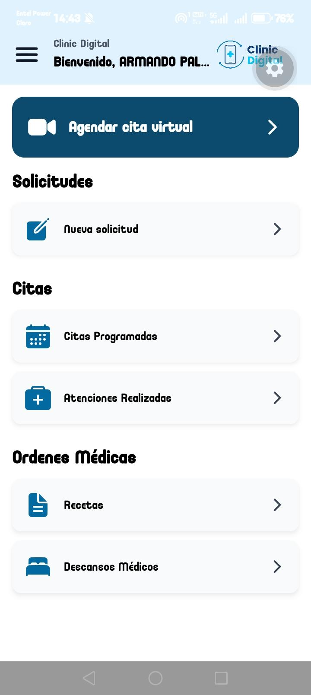

### Menú lateral

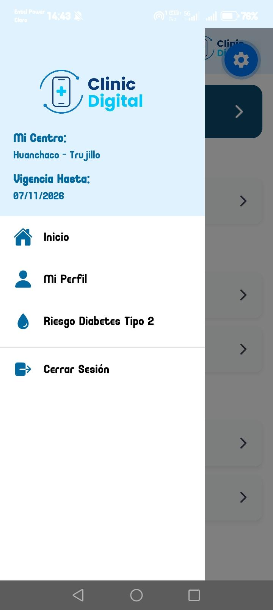

### Reservar cita: especialidad

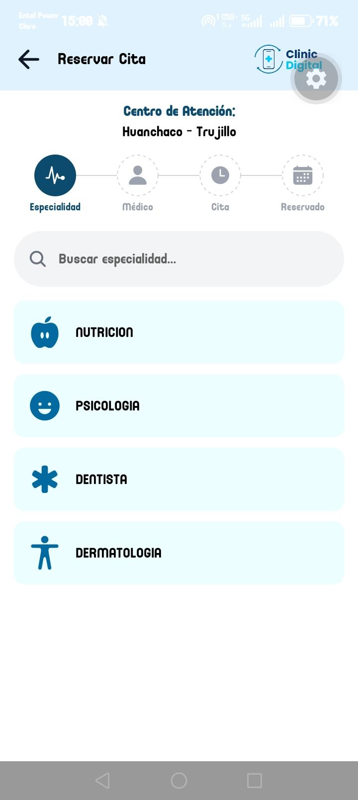

### Reservar cita: médico

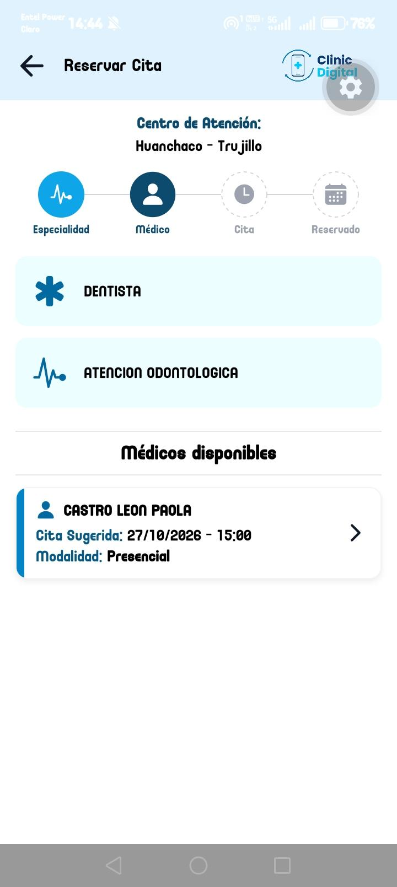

### Reservar cita: verificación de datos


### Reservar cita: fecha y hora

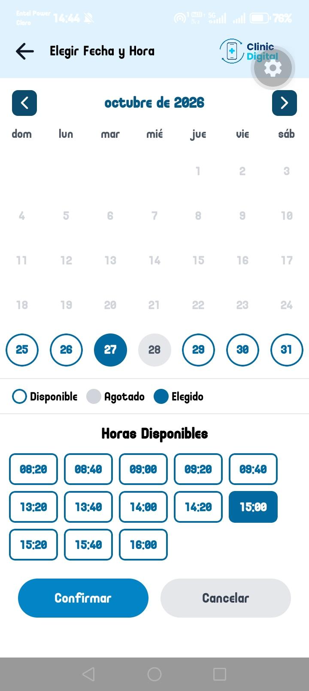

### Reservar cita: cita reservada

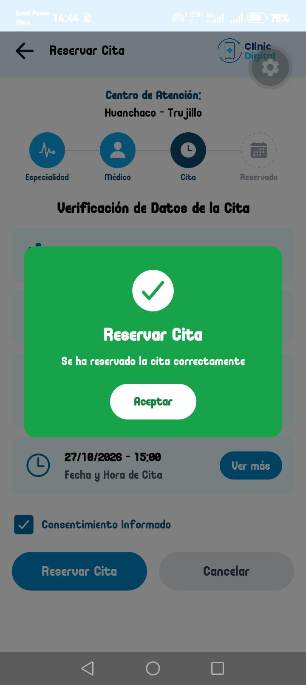

### Citas programadas

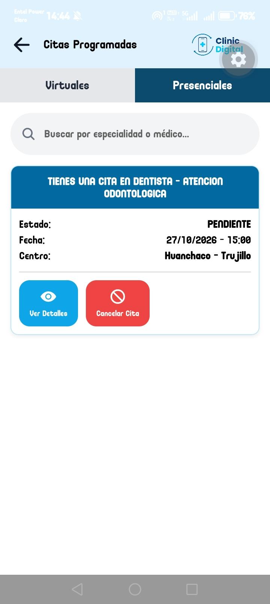

### Detalle de la cita

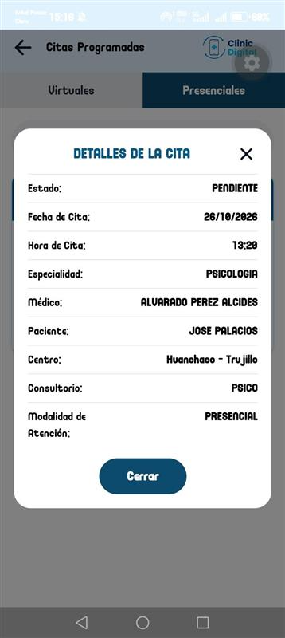

### Atenciones realizadas

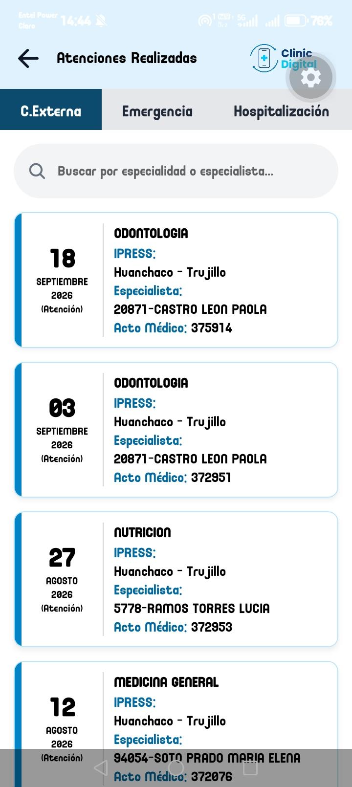

### Recetas

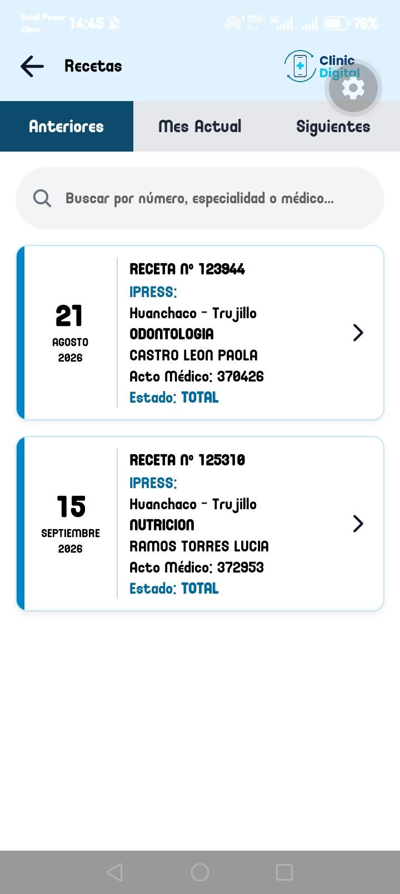

### Detalle de la receta

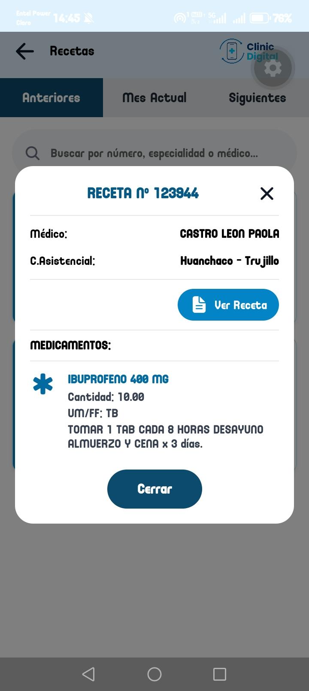

### Descansos médicos

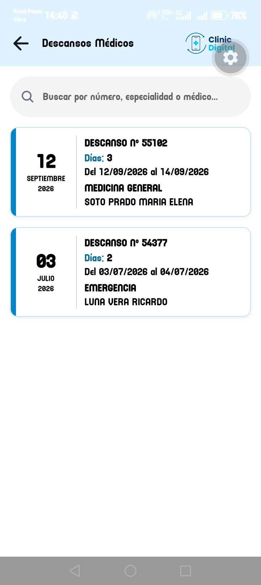

### Nueva solicitud

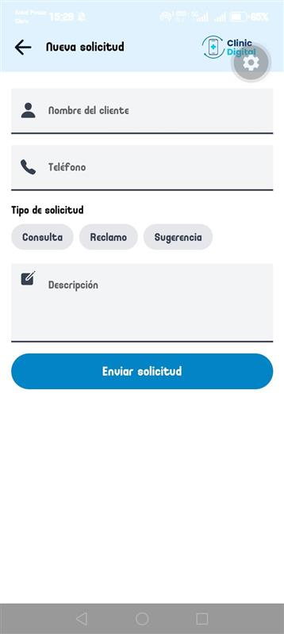

### Mi perfil

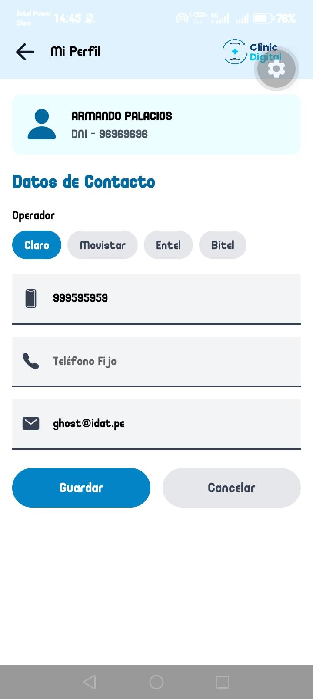

### Riesgo de diabetes tipo 2

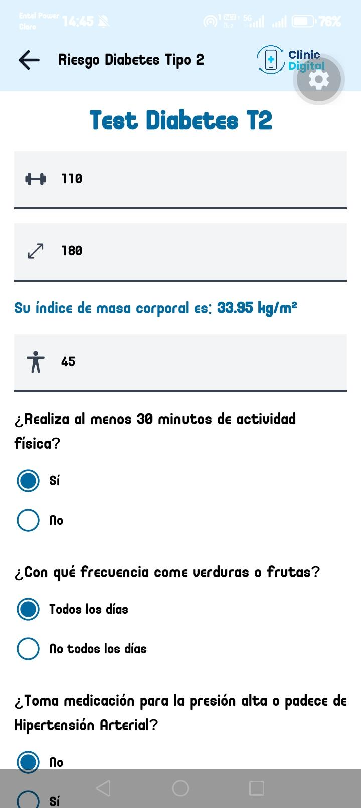

### Resultado del test

El test es referencial y no reemplaza una consulta médica.

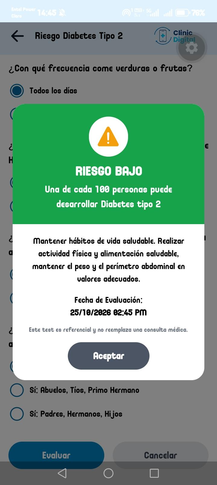